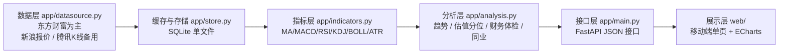

# stock-data · A 股行情与财务分析看板

移动端优先的个股查看与分析工具：打开就是一个手机友好的看板，输入代码即可切换标的。默认标的为 **春秋航空（601021.SH）**。

- **概览**：实时报价、关键指标、估值历史分位（PE/PB）、规则化综合评分、技术/财务/同业信号与风险提示
- **走势**：日/周/月 K 线 + MA5/10/20/60 + 成交量 + MACD，支持前复权/不复权与 3 月~全部区间
- **财务**：最新报告期指标、营收与归母净利趋势、毛利率/净利率/ROE/资产负债率趋势、报告期明细表
- **同业**：所属细分板块成分股对比（估值、涨跌、市值），本股高亮

> 本工具只做数据整理与规则化判断，**不构成任何投资建议**，也不接入任何交易通道。

## 架构



请求路径：接口层按 TTL 判断缓存是否新鲜 → 新鲜直接读 SQLite → 过期才回源数据源并写回缓存。数据源抖动时自动降级：报价切新浪、K 线切腾讯、仍失败则回退上一次缓存（响应里带 `degraded` 说明）。

## 目录结构

```
app/            后端：配置、数据源、存储、指标、分析、接口
web/            前端：index.html / style.css / app.js / vendor(echarts)
scripts/        selfcheck.py（全链路自检）、warm_cache.py（收盘后预热）
deploy/         Dockerfile、docker-compose.yml、systemd、Nginx、.env.example
data/           运行期生成：SQLite 缓存（已 gitignore，不入库）
```

## 本地运行

```bash
# 方式一：一键脚本（首次会自动建 venv 并装依赖）
./run.sh                      # 默认 http://127.0.0.1:8000

# 方式二：手动
uv venv --python 3.13 .venv
uv pip install --python .venv/bin/python -r requirements.txt
.venv/bin/python -m uvicorn app.main:app --host 127.0.0.1 --port 8000
```

自检（取数 → 指标 → 分析全链路，部署前建议先跑）：

```bash
.venv/bin/python scripts/selfcheck.py 601021
```

手机访问：终端里 `ipconfig getifaddr en0` 拿到本机内网 IP，手机连同一 WiFi 打开 `http://<IP>:8000`。

## 环境变量

| 变量 | 默认 | 说明 |
| --- | --- | --- |
| `STOCK_TOOL_DATA` | `./data` | SQLite 数据目录，建议指向数据盘 |
| `STOCK_TOOL_TOKEN` | 空 | 访问口令；设置后 `/api/*` 需要带 `?token=xxx` 或 `X-Access-Token` 头 |
| `STOCK_TOOL_TIMEOUT` | `12` | 单次请求超时（秒） |
| `STOCK_TOOL_BACKOFF` | `0.8` | 重试间隔基数（秒） |
| `STOCK_TOOL_INTERVAL` | `0.35` | 两次出网请求的最小间隔（秒），用于降低被数据源限流的概率 |

## 接口

| 路径 | 说明 |
| --- | --- |
| `GET /api/health` | 健康检查 + 存储统计 |
| `GET /api/search?q=` | 代码/名称联想搜索 |
| `GET /api/stock/{code}/overview` | 首屏：报价 + 全部分析结论（含 `degraded` 降级说明） |
| `GET /api/stock/{code}/kline?period=day&adjust=1&limit=250` | K 线 + 全部指标序列 |
| `GET /api/stock/{code}/financials?limit=8` | 最近 N 期财报主要指标 |
| `GET /api/stock/{code}/peers` | 所属板块与成分股对比 |
| `GET /api/stock/{code}/analysis` | 评分、信号、结论（不带原始 K 线） |

页面地址：`/`（可用 `/?code=600029` 直接指定标的）。

## 部署到阿里云 ECS

前置：安全组放行 80/443（若直接暴露 8000 则放行 8000）；ECS 需能出网访问数据源（国内地域正常）。

### 方案 A：Docker Compose（推荐）

```bash
# 在 ECS 上，脚本幂等，可反复执行
git clone git@github.com:doDomoGu/stock-data.git && cd stock-data
sudo bash deploy/deploy.sh
```

`deploy.sh` 会依次：检查 Docker（未安装时提示安装命令，或设 `ALLOW_INSTALL_DOCKER=1` 自动装）→ 生成访问口令写入 `deploy/.env` → 构建并启动容器 → 轮询 `/api/health` 直到就绪 → 打印容器状态与下一步。想指定口令用 `sudo STOCK_TOOL_TOKEN=你的口令 bash deploy/deploy.sh`。

等价的原始命令：

```bash
sudo yum install -y docker git || sudo apt-get install -y docker.io git
sudo systemctl enable --now docker
cp deploy/.env.example deploy/.env && vi deploy/.env     # 设置访问口令
docker compose -f deploy/docker-compose.yml up -d --build
docker compose -f deploy/docker-compose.yml logs -f      # 看启动日志
curl localhost:8000/api/health
```

compose 只把端口绑在 `127.0.0.1:8000`，对外由 Nginx 反代（见下），也可临时改成 `8000:8000` 用 `http://<公网IP>:8000` 直连。

### 方案 B：systemd 直跑（不用容器）

```bash
sudo mkdir -p /opt/stock-data && sudo chown -R $USER /opt/stock-data
git clone git@github.com:doDomoGu/stock-data.git /opt/stock-data && cd /opt/stock-data
uv venv --python 3.13 .venv && uv pip install --python .venv/bin/python -r requirements.txt

sudo cp deploy/stock-data.service /etc/systemd/system/
sudo systemctl daemon-reload && sudo systemctl enable --now stock-data
systemctl status stock-data
```

### Nginx 反向代理 + HTTPS

```bash
sudo cp deploy/nginx.conf /etc/nginx/conf.d/stock-data.conf
sudo vi /etc/nginx/conf.d/stock-data.conf        # server_name 改成域名或公网 IP
sudo nginx -t && sudo systemctl reload nginx
sudo certbot --nginx -d dodomogu.com -d www.dodomogu.com   # 需要域名时再上 HTTPS
```

### 挂到域名的子路径（如 https://dodomogu.com/stock/）

前端资源与接口都用**相对路径**解析，所以同一个服务既能跑在根路径，也能挂在任意子目录下，不需要改代码或加环境变量。

Nginx 只需要两段 location（完整示例见 `deploy/nginx.conf`）：

```nginx
location = /stock { return 301 /stock/; }        # 少了这个跳转，页面里的相对资源会按站点根目录解析而 404

location /stock/ {
    proxy_pass http://127.0.0.1:8000/;           # 结尾这个 / 负责剥掉 /stock 前缀
    proxy_set_header Host $host;
    proxy_set_header X-Real-IP $remote_addr;
    proxy_set_header X-Forwarded-Proto $scheme;
}
```

- **如果 dodomogu.com 已经有 server 块**（比如已有站点，或 certbot 生成的 443 配置）：只把 location 段并入那个 server 块，**不要整段复制**，否则 nginx 会因 `server_name` 重复而启动失败。改完先 `sudo nginx -t`。
- 挂子路径后访问地址是 `https://dodomogu.com/stock/`；带口令时用 `https://dodomogu.com/stock/?token=你的口令`，浏览器会把口令存在本地，之后直接访问 `/stock/` 即可。
- 路径对应关系：`/stock/` → 后端 `/`，`/stock/api/stock/601021/overview` → 后端 `/api/stock/601021/overview`，`/stock/style.css` → 后端 `/style.css`。

### 上线后建议做的三件事

1. **设访问口令**：公网可访问的看板务必设置 `STOCK_TOOL_TOKEN`，否则任何人拿到地址都能用。
2. **收盘后预热**：让手机端打开即秒出数据。
   ```bash
   # crontab -e，工作日 15:30 预热（默认预热 601021 及四家同业）
   30 15 * * 1-5 cd /opt/stock-data && .venv/bin/python scripts/warm_cache.py >> /var/log/stock-warm.log 2>&1
   ```
3. **备份数据目录**：SQLite 单文件，直接复制即可。
   ```bash
   0 3 * * * cp /opt/stock-data/data/market.db /opt/backup/market-$(date +\%F).db
   ```

## 关于数据库

**第一版用 SQLite，不需要独立数据库服务。** 这个场景是单机、读多写少、并发极低，SQLite 单文件同时充当行情缓存与历史数据仓库：避免频繁打公开接口被限流，也让页面秒开。

出现下面任一情况时再换成阿里云 RDS（PostgreSQL/MySQL）：多用户登录与权限、多实例并发写、数据量到千万行级、需要跨机器共享缓存。存储已封装在 `app/store.py`，换实现不影响上层。若将来要多实例部署，再引入 Redis 做报价缓存即可。

## 数据来源与口径

| 数据 | 主源 | 备用源 | 说明 |
| --- | --- | --- | --- |
| 实时报价 | 东方财富 | 新浪 | 新浪缺市值/换手率/量比时，用缓存与估值历史补齐并标记 |
| K 线 | 东方财富 | 腾讯 | 备用源无成交额/换手率，涨跌幅按相邻收盘价计算 |
| 财报指标 | 东方财富 | 无 | 报告期口径（一季报/中报/三季报/年报） |
| 估值历史 | 东方财富 | 无 | 近 1250 个交易日的 PE(TTM)/PB(MRQ)，用于分位计算 |
| 板块成分 | 东方财富 | 无 | 取名称含「航空/机场」的细分板块，比大类行业更可比 |

单位口径已统一：成交量一律为**手**，成交额为**元**，复权方式由 `adjust` 参数控制（0 不复权 / 1 前复权 / 2 后复权）。

## 已知限制

- 数据来自公开网页接口而非交易所授权数据，字段可能变更、限流或短时不可用；已做重试、多源切换与缓存回退，但**不保证实时性与完整性**。
- 没有 Level-2、逐笔、公告结构化、分析师预期数据。
- 航空业的客座率、ASK/RPK、单位客公里收益等经营指标来自公司月度经营公告，不在本数据源内；油价与汇率敏感性需另行测算。
- 综合评分是把四个维度归一化后的排序参考，权重写在 `app/analysis.py`，可按自己的标准改。

## 常见问题

- **启动报 `address already in use`**：端口被占用，`lsof -nP -iTCP:8000 -sTCP:LISTEN` 找到进程处理，或换 `--port`。
- **接口返回 503**：主备数据源同时不可用且本机无缓存。先看响应里的 `detail`，稍后重试；预热过缓存后基本不会再出现。
- **页面数据看着旧**：响应里的 `cached`/`degraded`/`stale` 字段会说明数据来自缓存；点右上角刷新按钮可强制回源。
- **前端改了没生效**：`style.css`/`app.js` 已设置为每次校验（`Cache-Control: no-cache`），浏览器普通刷新即可。
- **子路径下页面白屏或样式丢失**：多半是 nginx 少了 `location = /stock { return 301 /stock/; }`（访问时没带结尾斜杠），或 `proxy_pass` 结尾漏了 `/` 导致 `/stock` 前缀没被剥掉。
- **nginx 启动报 `conflicting server name`**：把 `deploy/nginx.conf` 整段复制进了已有 server 块的配置里，改成只并入 location 段。
